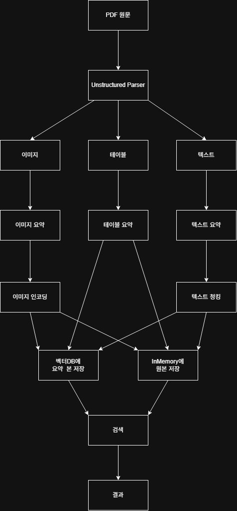
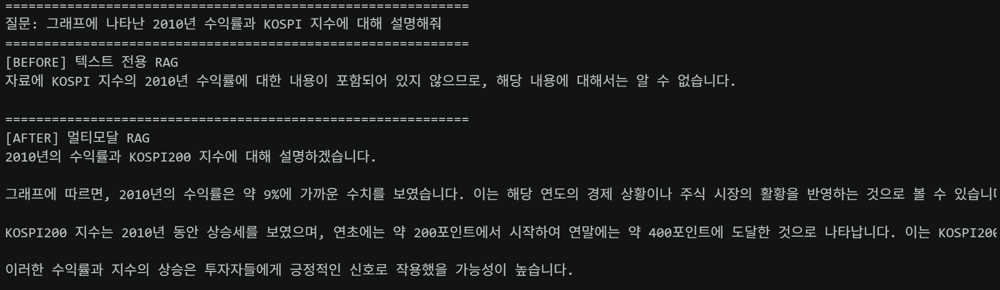

# 아키텍쳐 다이어그램


# 실행 방법
git clone <저장소 주소>
cd multimodal-rag

## 가상환경 생성 및 활성화
python -m venv .venv
source .venv/bin/activate          # 윈도우: .venv\Scripts\activate

## 의존성 설치
pip install --upgrade pip
pip install -r requirements.txt     # 또는 requirements.lock.txt

## 커널 등록
python -m ipykernel install --user --name multimodal-rag

## .env 작성
cp .env.example .env                # 윈도우: copy .env.example .env
## .env 파일을 열어 실제 API 키를 입력

# 디렉토리 구조
```
multimodal-rag/
├── .venv/                      # 가상환경 (Git 제외)
├── .env                        # API 키 (Git 제외, 절대 커밋 금지)
├── .env.example                # 키 없는 템플릿 (Git 포함)
├── .gitignore
├── requirements.txt            # 의존성 목록
├── requirements.lock.txt       # 버전 고정 파일
├── README.md                   # 포트폴리오의 얼굴
├── data/
│   ├── invest.pdf              # 원본 PDF
│   └── figures/                # 추출된 이미지 (Git 제외, 용량 큼)
├── notebooks/
│   └── Multi_modal_RAG.ipynb   # 실습 노트북
└── src/
    ├── extract.py              # PDF 파싱 함수
    ├── summarize.py            # 요약 체인
    └── retriever.py            # 다중 벡터 검색기
```
# 토큰 사용량 측정
텍스트 요약 토큰 사용량 (추정)
입력: 10882
출력: 1355
합계 토큰(천 단위 콤마): 12,237 토큰

요약한 이미지 수: 27 장

※ 실제 비용 = 토큰 수 x 단가. 단가는 OpenAI 공식 가격 페이지에서 확인하세요.
※ 이미지 토큰은 해상도에 따라 달라지므로 위 수치에 포함되지 않았습니다.

# 텍스트 전용 RAG와 멀티모달 RAG 차이


# Ollama를 이용한 번역 체인 통합
Ollama 번역 답변
---
```
질문 1: What are three things to watch out for during the autumn seasonal transition?
답변 1: 가을 계절 전환 시에 주의해야 할 3가지는?
```
---
```
질문 2: How can I prevent catching a cold when the weather changes in the fall?
답변 2: 여름이 가면 바람이 쥬는데, 어떻게 하면 감기가 잡히지 않게 할 수 있나요?
```
---
```
질문 3: What should I eat to keep my immune system strong during the change of seasons?
답변 3: 계절이 바뀔 때 내 면역 체계를 튼튼하게 유지하기 위해 무엇을 먹어야 하는지 알려주세요.
```
---
```
질문 4: Why do allergies and dry skin get worse in autumn, and how can I manage them?
답변 4: 가을에 알레르기와 피부가 왜 더 악화되는지 그리고 어떻게 관리하는지 알려주세요.
```
---
```
질문 5: How should I dress to handle big temperature differences between morning and evening?
답변 5: 아침과 저녁 사이에 큰 온도 차이를 겪을 때 어떻게 옷을 입으면 좋을까요?
```